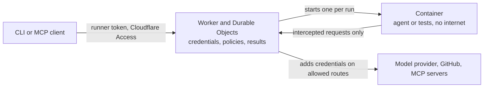

# Sandbox Runner

Run Claude Code, Codex and OpenCode in disposable sandboxes on your own Cloudflare account. Use your subscription or an API key. Decide what each run can reach.

## Why

A coding agent needs real access to do useful work: a model account, your repository, sometimes other tools. The agent also reads content that nobody has reviewed. A prompt injection in that content can make the agent run code that you did not intend ([OWASP Top 10 for Agentic Applications](https://genai.owasp.org/resource/owasp-top-10-for-agentic-applications-for-2026/), ASI01 and ASI05).

On a laptop, a VPS or a shared CI runner, that agent has your files, your network and often your keys within reach. Each run also leaves clones, worktrees, dependency folders and processes behind.

The current recommendation is containment, not trust ([Anthropic's agent containment guidance](https://support.claude.com/en/articles/17316105)). Give each agent its own isolated machine. Keep the credentials in a proxy outside that machine. Block outbound traffic by default. Sandbox Runner applies this to everyday agent work.

## What

Each run gets a sandbox: a new Linux machine for that run only. It is a Cloudflare Container, which [runs in its own virtual machine](https://developers.cloudflare.com/containers/architecture/). The agent can install packages, run code and edit files in it. It cannot reach your computer, your network or your credentials. When the run ends, the Worker destroys the container and everything in it.

- **Your subscription or your API key.** Claude Code and Codex use a Claude or ChatGPT subscription, or an API key. A strategy can start with the API key and change to the subscription when the provider confirms that the key's quota is exhausted. OpenCode uses an OpenAI or Anthropic key.
- **Credentials that the agent never sees.** The container has no internet access and holds placeholder values. The Worker adds the real credentials only to the requests that it allows. These are the model provider, a read-only fetch of your repository and the connectors of the run.
- **Control of each run.** You set the repository, the model, the effort and the MCP connectors. For each connector, you set the tool calls and the arguments that the agent can use. Reviews get read-only connector access.
- **Safe publication.** The container never pushes. The Worker creates one new branch from the changed files, after the container is gone.
- **Independent reviews.** A different agent reviews the commit, for example Codex checks the work of Claude Code.
- **Tests in a sandbox.** Run a Vitest suite or a test command. Dependencies come from the lockfile, and the network is closed while the tests run.
- **Start from anywhere.** Use a terminal or the local MCP server for any run. From ChatGPT, Claude, Claude Code or Codex, people who sign in through Cloudflare Access start the profiles granted to them. Your machine can be off during the run.
- **Nothing built up on your machine.** Your laptop or server runs only the client. Runs leave no clones, dependency folders, caches or processes on it. The CLI keeps only a small private journal of profile submissions.
- **A team without shared secrets.** Give each person or service only the profiles that it needs. People sign in with their own identity through Cloudflare Access. Scripts use their own tokens.



The [security model](docs/security.md) tells what is protected and what is not.

## How

Install the CLI, deploy the Worker to your Cloudflare account, connect a model provider, then start runs. The [quick start](#quick-start) shows the four steps.

Requirements:

| What | Cost | Notes |
| --- | --- | --- |
| Cloudflare account on the Workers Paid plan | US$5 per month | [Cloudflare Containers](https://developers.cloudflare.com/containers/pricing/) require it. |
| Container usage | Included, then billed by use | At the default size (0.25 vCPU, 1 GiB memory, 4 GB disk), the plan includes about 25 hours of runs each month. After that, a run costs about US$0.03 per hour. |
| Cloudflare Zero Trust | Free plan | Only for the remote MCP endpoint and sign-in with Cloudflare Access. |
| A model provider | Your subscription or API key | A Claude or ChatGPT subscription, or an Anthropic or OpenAI API key. API keys are billed by the provider: set a spending limit. |
| A GitHub App | Free | For every run on a repository, which includes all Vitest and test-command runs. Only private repositories are supported. |
| Node.js 24, Bun, Git, Docker and the Cloudflare `cf` CLI | Free | On the machine that deploys the Worker and connects credentials. Clients need Node.js only. Connecting a Claude subscription runs the local `claude setup-token`. |

Prices are Cloudflare's list prices on the date of this release. Check the pricing page before you rely on them.

Guides:

- **Install and operate:** [set up the Worker](#set-up-the-worker), [check](#check-a-cloudflare-installation) or [remove](#remove-a-cloudflare-installation) an installation, [connect a provider](#connect-or-reconnect-a-provider), [choose an authentication strategy](#choose-an-authentication-strategy).
- **Run work:** [run a prompt](#run-a-prompt), [use a private GitHub repository](#start-in-a-private-github-repository), [use MCP connectors](#use-mcp-connectors-in-claude-code-and-codex), [run Vitest](#run-a-vitest-suite) or [a test command](#run-a-test-command), [review a commit](#review-a-commit), [start OpenCode](#start-opencode).
- **Share and automate:** [save a run configuration](#save-a-run-configuration), [share profiles with a team](#share-profiles-with-a-team), [install the skill](#install-the-sandbox-runner-skill).
- **Contribute:** [test locally](#test-locally), [CONTRIBUTING.md](CONTRIBUTING.md), [RELEASING.md](RELEASING.md).
- **Questions:** [FAQ](#faq).

## Quick start

```sh
npm install --global sandbox-runner-cli

# Deploy the Worker and both container applications to your account.
sandbox-runner cloudflare setup my-sandbox-runner --account <id> --worker my-sandbox-runner \
  --secrets-file /path/to/sandbox-runner.secrets.env

# Connect a model provider. The credential is stored as a Worker secret.
sandbox-runner auth claude --mode subscription --account <id> --worker my-sandbox-runner

# Point the CLI at the Worker, then start a run.
export SANDBOX_RUNNER_URL=https://my-sandbox-runner.<subdomain>.workers.dev
export SANDBOX_RUNNER_TOKEN=<control token>
sandbox-runner claude start 'Summarize what a Durable Object is.'
```

The guides below explain each step, starting with the secrets file that setup needs.

## Set up the Worker

Use the installed CLI to initialize a Cloudflare project, install its locked dependencies, verify your Cloudflare account and build both Container applications.

```sh
sandbox-runner cloudflare setup my-sandbox-runner --account <id> --worker my-sandbox-runner --profile default --dry-run
sandbox-runner cloudflare setup my-sandbox-runner --secrets-file /path/to/sandbox-runner.secrets.env
```

Setup reuses an initialized project that matches the installed CLI template and reads its account, Worker and profile from the manifest. It keeps the project available if preparation, sign-in or deployment needs to be retried. Use the individual commands below to prepare and deploy a project you have customized and reviewed. The first deployment requires a secrets file with the control token and the admission guard token (see below). Connect the desired agent credentials after deployment.

You can also run the installation steps individually.

```sh
sandbox-runner cloudflare init my-sandbox-runner --account <id> --worker my-sandbox-runner --profile default
cd my-sandbox-runner
npm ci
sandbox-runner cloudflare login
sandbox-runner cloudflare deploy --dry-run
```

The generated project records the account, Worker, optional profile and ContainerHarness pin in `sandbox-runner.project.json`. It includes the locked Worker dependencies and an unmodified copy of the Worker configuration, which reads the installation's settings from that manifest (see [Installation settings](#installation-settings)). Init only writes local project files. Building them requires Node.js 24 or later, Bun, Git and Docker.

Login uses the Cloudflare profile recorded in the project and verifies access to its account. It reuses a working profile and starts the `cf` browser sign-in when needed. Pass `--force` to sign in again or `--no-browser` to approve the link from another device. Run it from the generated project directory or pass the directory as an argument. [Cloudflare CLI sign-in](https://developers.cloudflare.com/cf/get-started/#sign-in)

For the first deployment, create a private dotenv file with the control token and the [admission guard](#freeze-admissions-before-changing-worker-versions) token, and pass its path as `--secrets-file`. Keep both in your operator secret store. Connect agent credentials after deployment with `sandbox-runner auth` or agent setup.

```sh
umask 077
{ printf 'SANDBOX_RUNNER_TOKEN=%s\n' "$(openssl rand -hex 32)"
  printf 'SANDBOX_RUNNER_ADMISSION_CONTROL_TOKEN=guard-%s\n' "$(openssl rand -hex 32)"; } > /path/to/sandbox-runner.secrets.env
sandbox-runner cloudflare deploy --secrets-file /path/to/sandbox-runner.secrets.env
```

The guard must exist before the first run: it tracks every admission from then on, which is what lets `cloudflare upgrade` freeze and drain runs. It cannot be added to an installation that already ran.

Deploy checks the project's account and ContainerHarness pin, builds the initialized Worker in an isolated directory, then validates the prebuilt output with `cf deploy --dry-run`. The real upload requires the Worker and its Container application names to be free. Cloudflare applies uploads as upserts, so coordinate first deployments to the same names across operators. If the CLI returns `uncertain: true`, use `cloudflare doctor` and check the account's Container applications before retrying or changing resources.

### Upgrade an installation

Install the new CLI release, then upgrade each installation from its project directory:

```sh
sandbox-runner cloudflare upgrade my-sandbox-runner --dry-run --guard-url https://my-sandbox-runner.SUBDOMAIN.workers.dev --guard-token-file /path/to/guard.json
sandbox-runner cloudflare upgrade my-sandbox-runner --guard-url https://my-sandbox-runner.SUBDOMAIN.workers.dev --guard-token-file /path/to/guard.json
```

Upgrade first reads the installation and its guard. It then replaces the project's template files with this release's, keeps `sandbox-runner.project.json`, and runs `npm ci`. The manifest records the template only once `npm ci` has succeeded, so running upgrade again after a failure repeats the installation. With `--dry-run` it reports the files to replace; once the project matches, it also builds and checks the deployment, without changing anything. It then follows the [version-change procedure](#freeze-admissions-before-changing-worker-versions):

1. It checks that one version serves all traffic and records it as the rollback target, with the installation's Container applications and Durable Object namespaces.
2. It closes the admission guard. If runs are still draining, it stops with exit code `4` and the closure's `upgradeId`. Run it again with `--upgrade-id <uuid>` once the guard is drained; the same option adopts a closure you made yourself.
3. It deploys the build. The Worker keeps its secrets.
4. It checks that the new version serves all traffic with the same Container applications and namespaces, and that the guard reports the same drained closure from the new version.

Upgrade switches versions of an unchanged topology: it refuses a release or manifest that adds or renames a Durable Object or Container application (`cloudflare_upgrade_topology_changed`). It detects this after replacing the template files, which the project then keeps; such a release needs its own migration. Any error after the guard closed names the closure that keeps admissions frozen.

The receipt lists the previous and new versions and, under `guard.reopen`, the request that reopens admissions. Upgrade never reopens them: send that request once you have checked the new version. Upgrade verifies the deployment, not a run: after reopening, run a [canary](#inspect-and-test-the-installation) to exercise the Worker, the container runtime and the agent together. If the receipt reports `uncertain: true`, check the Worker before reopening; its message names the previous version.

`--guard-url` is the origin where the guard is reachable with a bearer token: the workers.dev host (with the [Access service token](#connect-an-mcp-client-with-your-identity) in the environment when Access protects it), or a loopback bridge. `--guard-token-file` holds the guard token, alone or as `SANDBOX_RUNNER_ADMISSION_CONTROL_TOKEN` in a JSON or dotenv file.

An installation created before guards were required has none. Pass `--without-guard`: nothing freezes admissions, so upgrade switches only when no container instance is active, assigned, starting or being scheduled (`cloudflare_upgrade_runs_active` otherwise). A run admitted between that check and the switch can still be interrupted.

### Run several installations

An installation is one Worker with its own Container applications, Durable Objects, secrets, team catalog and admission guard. To keep two teams, projects or environments apart, create one installation for each: a separate project directory with its own Worker name.

```sh
sandbox-runner cloudflare init runner-team-a --account <id> --worker runner-team-a
sandbox-runner cloudflare init runner-team-b --account <id> --worker runner-team-b
```

Installations share nothing at run time. A failed deployment, a closed admission guard or a leaked credential stays within its installation. Profiles, clients and runs belong to one installation, so profile names do not need to be unique across them.

Every project contains the same Worker template; only `sandbox-runner.project.json` differs. Projects initialized by earlier releases carry a rewritten `cloudflare.config.ts`; `cloudflare upgrade` replaces it with the shared template.

Use one installation for several projects when the same people may run any of its profiles. Use separate installations when the credentials, repositories or people must stay apart.

### Installation settings

Record what distinguishes an installation in its `sandbox-runner.project.json`. Every build of the project reads it, whether it runs through `cloudflare deploy`, `cloudflare upgrade` or a manual `cf deploy` from the project directory. Taking a new release then only replaces the template files.

```json
{
  "schemaVersion": 1,
  "worker": "runner-team-a",
  "maxConcurrentRuns": 4,
  "settings": {
    "SANDBOX_RUNNER_OPENCODE": "1",
    "SANDBOX_RUNNER_MCP_CONNECTORS": {
      "github": { "url": "https://api.githubcopilot.com/mcp/", "readAuth": "github-app", "writeAuth": "github-app",
        "read": [{ "tool": "issue_read", "match": { "method": "get", "owner": "owner", "repo": "repo", "issue_number": 7 }, "arguments": [] }],
        "write": [] }
    }
  }
}
```

`init` writes the account, Worker, profile and limit. `cloudflare access enable` adds the `access` block. Add the other entries by hand:

- `domain` publishes the Worker on a custom domain, such as `sandbox-runner.example.com`, on a zone of the installation's Cloudflare account. Deploying creates the domain and its DNS record; the workers.dev address stays enabled. Run `cloudflare access enable` again after adding it: the Access application then protects both addresses, and the MCP URL becomes `https://<domain>/mcp`. Clients connected to the workers.dev address keep working. Reconnect them to the new URL when convenient.
- `containers.agent.name` keeps an existing agent Container application whose name differs from the Worker name. Do not change it on a deployed installation: `cloudflare destroy` checks the receipt against it.
- `settings` sets the Worker's plain-text options: `SANDBOX_RUNNER_OPENCODE`, `SANDBOX_RUNNER_GITHUB_CHECKOUT_TIMEOUT_MS` (default 10 minutes), `SANDBOX_RUNNER_API_TIMEOUT_MS` (default 25 seconds), `SANDBOX_RUNNER_GITHUB_PUBLICATION_MAX_BYTES`, `SANDBOX_RUNNER_VITEST_TIMEOUT_MS` (default 15 minutes, at most six hours), `SANDBOX_RUNNER_AGENT_TIMEOUT_MS`, `SANDBOX_RUNNER_MCP_CONNECTORS` and `SANDBOX_RUNNER_GITHUB_ALLOWLIST`. Write the two JSON options as JSON or as text. The allowlist is usually a Worker secret; record it here only if the installation has no secret of that name.

The CLI and the build reject an unknown entry, an out-of-range timeout or malformed JSON. The Worker validates the other values when it admits a run. A project build reads these settings from its manifest only, so values exported for another installation never reach it; only builds from the repository checkout, without a manifest, read them from the environment, except the allowlist. `cloudflare deploy`, `cloudflare setup` and `cloudflare upgrade` refuse to run while one of them other than the allowlist is exported, rather than ignore it. Secrets stay on the Worker and never belong in the manifest. Every installation keeps SSH and log collection off for both Container applications, since containers handle run credentials and output.

These deadlines are failure containment, not targets: work that finishes earlier is unaffected. The checkout deadline bounds the container's Git fetch, which no request waits on. The API deadline bounds each operation the Worker runs against GitHub or an MCP connector: resolving the commit, checking connectors, and preparing or reconciling a run branch's publication as a whole. Some of those run while a start, status or result request waits, so keep it under the CLI's request timeout (`SANDBOX_RUNNER_TIMEOUT_MS`, 30 seconds by default). A start that both resolves a commit and checks OAuth connectors can wait for the resolution plus up to 30 seconds. Very large publications may need a higher value, at the cost of longer waits on those requests. Set them from durations observed on your repositories.

Each build also builds both container images from the template's Dockerfiles, so the images always match the Worker and its daemon. The Dockerfiles pin their base images by digest and their tools by version and checksum, and Cloudflare tags each build by its content, so an unchanged image is reused rather than pushed again. Building needs Docker on the machine that deploys.

The repository checkout also contains the Worker source.

Install Node.js 24 or later, Bun, Git and Docker. From this checkout:

```sh
cd worker
npm ci
npx --no-install cf auth whoami
npx --no-install cf deploy --dry-run
```

The installation fetches ContainerHarness at commit `1a450e71325c25ca1ec8b0013d756fe0c733b6f3`. To build from an existing Agents SDK checkout containing that commit, set `SANDBOX_RUNNER_SDK_CHECKOUT` to its path before running `npm ci`.

### Keep the Agents SDK pin current

ContainerHarness comes from the sources of the [Agents SDK](https://github.com/cloudflare/agents) at the commit pinned in `worker/prepare-sdk.sh`, not from an npm release. Maintainers check that pin before each release:

```sh
npm run check:sdk
npm run check:sdk -- --ref agents@0.33.0
```

The check needs `worker/pinned-src`, which `npm ci` in `worker/` prepares. It follows the imports of the Worker and the container daemon into the pinned source to find the SDK files they use, then asks GitHub which files changed between the pin and the ref (`main` by default). It prints the changed files the runner uses, other changes under `harness/`, and the commits in between. Exit code `0` means no used file changed, `1` means at least one did, or GitHub truncated the comparison, and `2` means the check could not run. Set `GH_TOKEN` to raise GitHub's rate limit.

When a used file changed, read those commits. To take them, set the new commit in `prepare-sdk.sh` and the README, run `npm ci` in `worker/` to rebuild ContainerHarness and the daemon, run the tests and the local smoke runs, then release. Each installation then takes the release with `cloudflare upgrade` and a canary once admissions reopen.

Create a secrets file outside the checkout, readable only by you, with `SANDBOX_RUNNER_TOKEN` and `SANDBOX_RUNNER_ADMISSION_CONTROL_TOKEN` as for `cloudflare deploy`. Deploy the Worker with that file.

```sh
npx --no-install cf deploy --secrets-file /path/to/sandbox-runner.secrets.env
```

## Check a Cloudflare installation

### Limit concurrent runs on a new installation

Pass `--max-concurrent-runs <count>` to `cloudflare init` or `cloudflare setup` when creating a new installation. Choose a positive integer. The project manifest records the value, and the first deployment verifies that the Worker, Container applications and associated Durable Object namespaces are new. The deployment receipt reports the chosen limit.

Each admitted operation ID occupies one slot from reservation through confirmed sandbox destruction. An authentication strategy shares its slot across attempts. Reviews and test runs use the same limit. An unfinished publication or failed cleanup keeps the slot. The Worker reconciles released slots from the durable run state, so a new submission can still see `installation_capacity` briefly after cleanup.

A full installation returns `installation_capacity` with CLI exit code `4`. An uncertain admission returns `admission_unconfirmed` with exit code `6`. Repeat the same input and operation ID to reconcile. Existing runs remain readable and replayable at capacity.

Installations created without a limit remain unconfigured. The first-deployment option applies to new installations. Enabling a limit on an existing installation requires an attested drain of its earlier runs.

### Freeze admissions before changing Worker versions

`cloudflare deploy` installs the `SANDBOX_RUNNER_ADMISSION_CONTROL_TOKEN` secret with the first version, from the secrets file. It is `guard-` followed by 64 lowercase hexadecimal digits. Store it separately from the run and team credentials. `cloudflare upgrade` drives the protocol below; the table documents it for operators and other tooling.

The operator API uses this token as the `Authorization: Bearer` credential. It is unavailable to run and team credentials, and the guard token cannot submit runs. Use the installation's authenticated ingress.

| HTTP request | Effect |
| --- | --- |
| `GET /v4/admissions/guard` | Read the persisted closure, responding Worker version, pending count and page of unsettled admissions. |
| `GET /v4/admissions/guard?after=GENERATION` | Continue the pending page using the preceding `nextCursor`. |
| `POST /v4/admissions/guard` with `{"action":"close","upgradeId":"UUID"}` | Start or reread the same closure and record its generation. |
| `GET /v4/admissions/guard/UUID` | Read the tracked operation's client, generation and reconciliation state. |
| `POST /v4/admissions/guard` with `{"action":"open","upgradeId":"UUID","generation":"N"}` | Reopen the same closure or abort its drain. A stale or conflicting operation returns HTTP 409. |

While closed, fresh submissions receive `installation_maintenance`. Matching requests can still replay their recorded run and use status, result, list, events and cancel. A pending UUID is either fenced before a run exists or reconciled to terminal cleanup and its exact client row in the index. A cleanup failure or a client index mismatch blocks drainage. The recorded reply for a fenced UUID is distinct from a 404 for an unknown UUID. Track unresolved admissions from CLI journals and use the same operation IDs for reconciliation.

The guard adds no concurrency ceiling. Existing installations with untracked history may still admit runs while open. Closing stops fresh submissions, and `legacy_unverified` means the Worker cannot prove their drainage. There is no override that certifies these historical operations. Assign one operator or deployment process to serialize close, drain, version switch and reopen. Require `drained` for the exact closure ID and generation, and verify the serving Worker version and unchanged `RunIndex` namespace with `cf` before switching. After switching, confirm 100% traffic on the intended version and read back the same closure, generation and namespace before reopening. The two versions participating in a rollback must both enforce this protocol. If an older version lacks it, keep an independent ingress freeze through the version change. Restore a guard-compatible deployment before reopening those admissions.

### Inspect and test the installation

```sh
sandbox-runner cloudflare doctor --account <id> --worker <name> --profile default
```

Doctor uses the same target flags and environment variables as `auth`. It reads the selected account, the Worker version serving all traffic, the Sandbox Runner binding metadata, and the link from the `Run` Durable Object to its Container application. Its JSON reports each known provider credential binding as `present`, `missing` or `invalid`. `ready` means the Cloudflare checks passed and at least one provider credential binding is present. Exit code `3` indicates incomplete setup or an unverified check. Exit code `5` indicates that the diagnostic exceeded `SANDBOX_RUNNER_TIMEOUT_MS`.

Doctor makes read-only Cloudflare API calls. Credential validity and container startup require a canary run.

Run a canary against the deployed gateway selected by `SANDBOX_RUNNER_URL` and `SANDBOX_RUNNER_TOKEN`.

```sh
sandbox-runner cloudflare canary claude --auth subscription --timeout-ms 120000
sandbox-runner cloudflare canary codex --auth api-key --timeout-ms 120000
sandbox-runner cloudflare canary vitest --repo OWNER/REPO --sha COMMIT_SHA --timeout-ms 120000
```

Claude Code and Codex canaries require the agent to return a value derived from the run ID. Omit `--auth` to exercise the configured strategy, or choose a mode to test its credential directly. Supply `--repo` and `--sha` together to exercise a private checkout. The Vitest canary requires both and expects the suite at that commit to pass. All three wait for verified container cleanup. The JSON receipt reports the run ID, outcome and cleanup. Vitest also reports its verified commit and image digest.

Use `--operation-id` to retain the ID before submission. Repeat the same command with that ID and options to recover an uncertain submission. To continue waiting after the CLI stops, use `wait` with the same ID or repeat the canary to verify its success condition.

## Remove a Cloudflare installation

Save the JSON receipt from a successful `cloudflare setup` or `cloudflare deploy` command. From the initialized project directory, preview the removal and use the same receipt to confirm it.

```sh
sandbox-runner cloudflare destroy --receipt /path/to/deploy.json --dry-run
sandbox-runner cloudflare destroy --receipt /path/to/deploy.json
```

Destroy uses the project account and Cloudflare profile. It verifies the receipt's version in the Worker's history, the single active version and the exact Container application and Durable Object namespace identities. Credential rotations and settings changes can activate a new version of the same installation. `--dry-run` only reads Cloudflare metadata and reports which verified resources are present.

The real command deletes the Worker by its Cloudflare ID and removes any of its attested Container applications still present afterward. It confirms that the Worker, those applications and their namespaces are absent. Worker deletion removes its versions and run history. Coordinate changes to the installation with other operators during removal. If a response is lost, the CLI checks the inventory before continuing. If it returns `uncertain: true`, inspect with `--dry-run` and the same receipt before resuming.

The JSON reports `images: "retained"`. The receipt identifies the installation, while registry tags may have other consumers. Review those tags separately if you want to remove them.

## Connect or reconnect a provider

Install the CLI from the checkout root with `npm install -g .`. Put `cf` on your PATH or set `SANDBOX_RUNNER_CF_BIN` to the absolute path of the `cf` executable. Choose the Cloudflare account ID, the deployed Worker name and the agent's authentication mode.

```sh
export CLOUDFLARE_ACCOUNT_ID='<cloudflare-account-id>'
export SANDBOX_RUNNER_WORKER='sandbox-runner-j1'
sandbox-runner auth claude --mode subscription --profile default
sandbox-runner auth codex --mode subscription --profile default
```

You can also supply the target with `--account` and `--worker`, and select a Cloudflare profile with `SANDBOX_RUNNER_CF_PROFILE`. The command verifies the target's active Sandbox Runner version before asking for authorization. It updates the selected secret with `cf` and verifies the new active version and binding.

Interactive messages for `auth` and `connector login` support English and French. Set `SANDBOX_RUNNER_LANG=fr` to choose French explicitly. The terminal otherwise uses the first nonempty setting among `LC_ALL`, `LC_MESSAGES`, and `LANG`. The local OAuth callback uses the browser's `Accept-Language` preferences when `SANDBOX_RUNNER_LANG` is unset. Regional variants such as `fr-BE` use the French catalog. English is the fallback. The structured JSON and MCP contracts stay stable across languages.

| Agent | `--mode` | Worker secret |
| --- | --- | --- |
| Claude Code | `subscription` | `CLAUDE_CODE_OAUTH_TOKEN` |
| Claude Code | `api-key` | `ANTHROPIC_API_KEY` |
| Codex | `subscription` | `OPENAI_SUBSCRIPTION_OAUTH_TOKEN` |
| Codex | `api-key` | `OPENAI_API_KEY` |

For Claude Code subscription on macOS, `sandbox-runner auth` runs the local `claude setup-token` command. Approve access in the browser. If Claude gives you a browser authorization code, enter it in the terminal and press Enter. Sandbox Runner captures the resulting token in memory and publishes it through `cf`. Use `SANDBOX_RUNNER_CLAUDE_BIN` to select a specific local Claude executable. The browser flow allows ten minutes by default. Set `SANDBOX_RUNNER_CLAUDE_SETUP_TIMEOUT_MS` to change the timeout in milliseconds. [Claude Code authentication](https://code.claude.com/docs/en/authentication#generate-a-long-lived-token)

If automatic capture is unavailable, the command offers masked input. Use `--manual` to start with that prompt. Run `claude setup-token` in a private terminal, paste the token at the masked prompt, press Enter, then Ctrl-D. The CLI reads the entire paste, removes line breaks and spaces inserted by the terminal, and checks the Claude OAuth format.

For Codex subscription, confirm Sign in with ChatGPT in the browser on the same machine. Select the ChatGPT account and workspace whose plan you want to use. The CLI saves registration metadata locally and publishes the access token to the Worker. Run the command again to reconnect when the grant expires or is revoked.

Choose `--mode api-key` to use a key billed by the provider. For an unattended Claude subscription or API key update, use `--stdin` with input from a protected file or your secret manager. The interactive masked prompt uses a POSIX terminal.

```sh
sandbox-runner auth codex --mode api-key --profile default --stdin < /path/to/protected-key-file
```

## Choose an authentication strategy

Update the CLI and deploy a Worker from a release that supports authentication strategies before running setup.

```sh
sandbox-runner claude setup --profile default
sandbox-runner codex setup --profile default
```

Setup uses the same account, Worker and Cloudflare profile options as `auth`. It connects any missing credentials and saves one strategy per agent on the target Worker. Each credential update becomes active when it is published. The previous strategy or default mode applies until setup publishes the new choice.

| Strategy | First attempt | Second attempt after confirmed quota exhaustion |
| --- | --- | --- |
| `api-key-only` | API key | — |
| `api-key-first-then-subscription` | API key | Subscription |
| `subscription-only` | Subscription | — |
| `subscription-first-then-api-key` | Subscription | API key |

For any strategy that uses an API key, configure a spending limit with the provider and confirm it during setup. The provider enforces the limit. Setup records your confirmation.

Treat API-key runs as potentially billable. The provider determines which credits apply. Anthropic's coverage table excludes Claude Code. Its help center describes some self-run `claude -p` requests as Agent SDK usage. The billing classification of the hosted Sandbox Runner canary remains unverified. OpenAI's subscription API-credit benefit excludes Codex usage through API keys. [Anthropic coverage](https://platform.claude.com/docs/fr/about-claude/api-credits-for-subscribers#what-the-credits-cover) · [Anthropic FAQ](https://support.claude.com/en/articles/17154008-monthly-api-credits-for-max-ultra-and-team-plans) · [OpenAI API credits](https://developers.openai.com/api/docs/guides/chatgpt-api-credits#what-the-credits-cover)

To configure a strategy from a script, connect the required credentials first and pass `--strategy` explicitly. For strategies that use a key, pass `--confirm-api-spend-cap` after enabling the provider limit.

```sh
sandbox-runner claude setup --strategy api-key-first-then-subscription --confirm-api-spend-cap
sandbox-runner codex setup --strategy subscription-only
```

## Configure Claude Code defaults

Update the CLI and deploy a Worker that supports Claude defaults. Use the same Cloudflare account, Worker and profile options as `auth` to save one or both values on that Worker.

```sh
sandbox-runner claude setup --model claude-sonnet-5-5 --effort medium
sandbox-runner run --agent claude --effort high 'Review the tests in this repository.'
```

Run settings setup separately from auth strategy setup. It updates only the fields you supply and uses your existing credentials. Cloudflare requires the latest Worker version to be fully deployed before it accepts this update. On a new run, `--model` and `--effort` override their respective Worker defaults for that run. With no value configured for a field, Sandbox Runner uses its existing behavior. Supported effort values are `low`, `medium`, `high`, `xhigh`, and `max`. Claude Code applies the capabilities and effort limits of the selected model and account.

Sandbox Runner keeps the selected settings with the run, including across authentication fallback and retries with the same operation ID. `status` and `result` include `model` and `effort` when selected by the Worker or the caller. For a strategy run, they also appear on each attempt. On the legacy submission API, per-run overrides use `POST /v3/runs`.

## Choose a sandbox provider

The sandbox provider runs the container. Cloudflare is the available provider. To save the default on the gateway, deploy a Worker that supports provider-aware runs, then use the same Cloudflare account, Worker and profile options as `auth`.

```sh
sandbox-runner setup --default-sandbox-provider cloudflare --profile default
```

Setup updates `SANDBOX_RUNNER_DEFAULT_SANDBOX_PROVIDER` through `cf` and verifies the active Worker version. Cloudflare requires its latest Worker version to serve all traffic before the update.

Use `claude start` or `codex start` to submit through `POST /v4/runs`. Omit `--sandbox-provider` to use the gateway's default, which is Cloudflare until configured. Pass the option to choose the provider for this run. An unavailable provider is rejected before the Worker reserves a run. The gateway saves the resolved provider with the run. Its ID, `kind` and `sandboxProvider` appear in the submission, status and result JSON.

```sh
sandbox-runner claude start --effort high 'Review the tests in this repository.'
sandbox-runner codex start --sandbox-provider cloudflare 'Respond with the word READY.'
```

`run --agent` also uses `POST /v4/runs` when you pass `--sandbox-provider` or supply a Codex model or effort override. Otherwise it retains its existing `/v1`, `/v2` or `/v3` submission route when no other v4 option applies. Use the same `status` and `result` commands for either form.

## Start OpenCode

OpenCode 2.2.7 is bundled in the Cloudflare agent image. Enable it on a new installation by recording `"SANDBOX_RUNNER_OPENCODE": "1"` in the project's [settings](#installation-settings) before `cloudflare deploy` or `cloudflare setup`. Builds from the repository checkout read `SANDBOX_RUNNER_OPENCODE=1` from the environment instead. Use `cloudflare doctor` to check the active capability and whether each dedicated provider binding is present. Configure the API key for each provider you intend to use.

```sh
sandbox-runner auth opencode --model-provider openai --account <id> --worker <name> --profile default
sandbox-runner auth opencode --model-provider anthropic --account <id> --worker <name> --profile default
```

Auth uses masked input and publishes through `cf` after verifying the active Worker. It updates `SANDBOX_RUNNER_OPENCODE_OPENAI_API_KEY` or `SANDBOX_RUNNER_OPENCODE_ANTHROPIC_API_KEY`. Each run uses only its chosen provider's dedicated key. The key stays in the Worker. API usage is billed by the selected provider.

```sh
sandbox-runner opencode start --model-provider openai 'Respond with the word READY.'
sandbox-runner opencode start --model-provider anthropic --effort high 'Respond with the word READY.'
```

The OpenAI route uses Chat Completions with `gpt-4.1-mini`. The Anthropic route uses Messages with `claude-sonnet-5-5` and accepts `--effort high`. Omit `--model` to use the selected provider's model. OpenCode runs accept a prompt and use the v4 submission route. For a private GitHub workspace, pass `--repo OWNER/REPO` and `--sha COMMIT_SHA` together. OpenCode supports read-only checkout with the selected provider's API key. Publication and subscription auth are unavailable for OpenCode.

OpenCode has the same `status`, `wait`, `result`, `cancel`, `events` and `list` operations. Submission, status and result include the model provider and effective model, plus effort when supplied. OpenCode counts toward the installation's active-run limit and accepts `--run-timeout-ms` for the run deadline. To reconcile a submission, reuse the same operation ID, prompt and options, including the presence or absence of model, effort and deadline overrides. The current CLI opts into OpenCode entries in `list`. Earlier CLIs can still list their supported runs against the new Worker and use their existing cursors.

Before enabling OpenCode on an existing installation, prepare a version you can roll back to that understands the OpenCode index filter. A version from before the filter can return OpenCode entries to earlier CLIs after the first OpenCode admission. The first-install command `cloudflare deploy` rejects existing installations.

## Start in a private GitHub repository

On the Worker, configure `GITHUB_APP_CLIENT_ID`, `GITHUB_APP_INSTALLATION_ID`, and `GITHUB_APP_PRIVATE_KEY` as secrets for a GitHub App installed on the private repositories you intend to use. Set `SANDBOX_RUNNER_GITHUB_ALLOWLIST` to a JSON object mapping each `owner/repo` to its numeric GitHub repository ID. The Worker requests a short-lived installation token limited to the selected repository with read access to contents and metadata. The container receives the repository slug and commit SHA without the installation token.

```sh
sandbox-runner claude start --repo owner/repo --sha 0123456789abcdef0123456789abcdef01234567 'Review the changed tests.'
```

`claude start`, `codex start`, `opencode start`, `vitest start` and `test` accept `--repo` with a full commit SHA in `--sha` or a full Git reference in `--ref`, such as `refs/heads/team/release` or `refs/tags/v2.0`. Use the allowlist's exact repository spelling. Use `--sha` for `review` and a full SHA in MCP repository inputs. OpenCode uses the Worker's inline provider configuration with project configuration discovery disabled.

For a new operation with `--ref`, the Worker resolves the branch or tag through the selected GitHub App before it admits the run. The first confirmed admission pins the commit. The agent starts in `/workspace` after checkout verifies the pinned SHA. Submission, status, and result include `repository.slug` and `repository.sha`. Keep the original reference and operation ID when retrying, even if the branch has moved. Switching to `--sha` under that same operation ID conflicts with the original request.

While the reference resolves, `result` reports `run_in_progress`. A cancellation request returns `admission_in_progress` while the run has yet to be admitted. Retry cancellation once status confirms admission. The Worker uses `SANDBOX_RUNNER_API_TIMEOUT_MS` to bound reference resolution, before the run's own deadline starts.

If the remote does not advertise direct SHA fetch, checkout tries commits reachable from the same repository's advertised branch heads. Checkout fails if it cannot retrieve and verify the requested SHA within the configured deadline. Raise `SANDBOX_RUNNER_GITHUB_CHECKOUT_TIMEOUT_MS` in the [installation settings](#installation-settings) for repositories requiring more than its 10-minute default. Checkout skips submodule initialization, Git hooks, and filters. Each authentication strategy attempt gets its own checkout at the same SHA.

### Publish a run branch

Pass `--publish` on `claude start` or `codex start` to authorize the Worker to create the branch `sandbox-runner/<run-id>` in the selected repository. The GitHub App needs **Contents: write** permission on that repository. The container uses its usual read-only Git route. The Worker obtains the write grant for publication and limits it to the selected repository.

```sh
sandbox-runner claude start --repo owner/repo --sha 0123456789abcdef0123456789abcdef01234567 --publish 'Fix the failing tests.'
sandbox-runner wait <run-id>
```

Publication includes regular tracked edits and deletions and regular untracked files allowed by the workspace's `.gitignore` rules. The Worker verifies the candidate tree and creates a commit with the supplied base SHA as its sole parent. It creates the run branch once and verifies its target. `publication.status` reports progress and `publication.branch`, `commitSha`, and `treeSha` identify a verified publication. A clean workspace reports `no_changes`. Configure a smaller transfer budget with `SANDBOX_RUNNER_GITHUB_PUBLICATION_MAX_BYTES` in the [installation settings](#installation-settings).

The agent's output remains available if publication fails. `wait` waits for publication and cleanup. Cancelling before the reference creation claim closes publication. After a claimed reference request, the Worker checks the branch with a read-scoped token and a fresh deadline. If the branch remains ambiguous after the recovery window, the result reports `uncertain`. Use `status` or `wait` with the same run ID to request another readback. Keep `--publish` unchanged when retrying the same operation ID.

For a run with an execution deadline, `status`, `list`, and `events` show the root as running while publication is pending. The deadline covers workspace export, Git object creation, and the reference creation claim. If the deadline expires before a claim, publication closes with `github_publication_run_timed_out`. When a ref request may already have reached GitHub, readback can continue after the deadline. A verified branch and SHA appear in the timed-out result, and `wait` exits `5` after cleanup and readback settle.

Codex publication requires Linux child subreaper and pidfd support. The supervisor verifies that all its descendants have exited before the Worker can export the workspace. The checkout timeout also bounds that drain. In the tested local AMD64 emulation on an ARM64 Docker host, `pidfd_open` returned `ENOSYS` and the publication run stopped before launching Codex.

## Use MCP connectors in Claude Code and Codex

Pass `--mcp` once for each configured connector. The Worker assigns read-write access to `claude start` and `codex start`. It assigns read-only access to `review`, regardless of the selected model or authentication mode. The run receipt reports the assigned mode and connector names in `connectorAccess`.

```sh
sandbox-runner claude start --repo owner/repo --sha "$commit" \
  --mcp github --mcp tracker 'Update issue 7 with the result.'
sandbox-runner review --agent codex --producer-agent claude --repo owner/repo --sha "$commit" \
  --mcp github --mcp tracker 'Read issue 7 and verify the result.'
```

These roles apply to connector calls from a run. Anyone who holds the installation control token can submit executor runs and should be trusted to use the configured write rules. The sandbox receives the selected connector names and talks to the internal gateway. The gateway applies its rules both to discovery and to each tool call. Model credentials and connector credentials stay on the Worker.

Set `SANDBOX_RUNNER_MCP_CONNECTORS` to a JSON object in the [installation settings](#installation-settings). For each connector, set its HTTPS `url`, credential references `readAuth` and `writeAuth`, and the arrays `read` and `write`. A rule has a `tool`, exact argument values in `match` and an `arguments` array of other argument names the agent may supply. Read-write combines both rule arrays. Pin any argument that selects the action or resource. Read-only runs receive the `read` rules, so put every action that changes data in `write` only. A write may be attempted once per request ID. If it may have reached the connector, check its outcome upstream before submitting another run. The Worker suppresses model-auth fallback after it claims a write and reports `connectorFallbackBlocked` when a later quota failure would otherwise have switched authentication routes.

For GitHub, use `https://api.githubcopilot.com/mcp/` and `"github-app"` for both credential references. Rules pin `owner` and `repo` to the exact spelling in the checkout allowlist. For example, a rule for reading one issue is `{"tool":"issue_read","match":{"method":"get","owner":"owner","repo":"repo","issue_number":7},"arguments":[]}`. An Issues write needs an explicit write rule and GitHub App **Issues: write**. The Worker mints repository-scoped installation tokens with **Contents: read** and **Issues: read** or **Issues: write** according to the run mode. The GitHub App must have access to the remote MCP service.

To inspect GitHub Actions and Checks for the run's immutable checkout SHA, add the read rule `{"tool":"get_commit_ci","match":{"owner":"owner","repo":"repo"},"arguments":["page"]}` to that connector. The tool returns workflow and check names, statuses, conclusions, and GitHub links. It takes no branch, SHA, workflow, or run ID from the agent and exposes no log or artifact content. Grant **Actions: read** and **Checks: read** to the existing GitHub App and approve the updated permissions on its installation. The Worker mints a separate installation token for this capability, scoped to the selected repository and the two read permissions.

For Context7 public documentation, use `https://mcp.context7.com/mcp` with `context7-public` for both credential references. Allow only `resolve-library-id` and `query-docs` in `read` and leave `write` empty. The relay sends no credentials to Context7. Keep documentation queries generic because they leave the sandbox.

For Context7 browser authorization, use `https://mcp.context7.com/mcp/oauth` with the same `SANDBOX_RUNNER_MCP_CREDENTIAL_CONTEXT7` reference for both modes and the same read-only rules. Run `sandbox-runner connector login context7 --mode read-only --scope 'profile email offline_access'` against the configured Worker. The gateway pins the issuer and uses the renewable grant.

For a dedicated Paddle Sandbox profile, point the connector at `https://sandbox-api.paddle.com/` with `SANDBOX_RUNNER_MCP_API_KEY_PADDLE_SANDBOX` for both auth references. Provision a sandbox API key with `price.read` and `product.read` only. Use `paddle_get_price` and `paddle_get_product` in `read`, pin `id` to the catalog item under test, and leave `write` empty. The gateway returns selected standard catalog fields.

For a dedicated PostHog test profile, set `url` to the exact query API URL for your isolated test project, for example `https://eu.posthog.com/api/projects/123/query/`. Use `SANDBOX_RUNNER_MCP_API_KEY_POSTHOG` for both auth references. Provision a personal API key limited to that project and `query:read`. In `read`, allow `posthog_count_events`, pin `event` and `testRunProperty`, allow the `testRunId` and `minutes` arguments, and leave `write` empty. Instrument the test run to send its UUID in the configured property. The tool returns a fresh count for that tag over 15, 30, or 60 minutes.

Publish these dedicated keys as Cloudflare Worker secrets through `cf`, using masked input or stdin. Each binding is installation-wide. Deploy provider configuration only for environments that the corresponding key is authorized to read. After rotating the key, resubmit any affected run that was interrupted by the credential change.

For another remote MCP server that uses OAuth, configure a connector such as `tracker` at the server's exact MCP URL, for example `https://mcp.example.com/mcp`. Pin the arguments that select the action and the resource in each rule. A read rule for listing the items of one project is `{"tool":"list_items","match":{"project":"01234567-89ab-4cde-8f01-23456789abcd"},"arguments":[]}`. Use a `SANDBOX_RUNNER_MCP_CREDENTIAL_…` secret reference for each OAuth grant. Repeat the login for each distinct credential reference, selecting an identity with access to the pinned resource.

`connector login` supports servers that follow the MCP authorization specification on a single origin. The server must publish protected resource metadata (RFC 9728) whose `resource` is exactly the connector URL and that names one authorization server on the same origin. That server's metadata (RFC 8414) must offer dynamic client registration, PKCE with `S256`, the `authorization_code` and `refresh_token` grants, and the `none` token endpoint authentication method. Otherwise the login stops with `connector_oauth_discovery_failed`.

When you change a connector's URL, update it in the Worker configuration and deploy the configuration before running `connector login` again. The stored OAuth grant is bound to its exact resource URL.

```sh
sandbox-runner connector login tracker --mode read-only --scope 'items.read items.write' \
  --account "$cloudflare_account" --worker "$worker"
```

The command opens the provider's authorization page in your browser, publishes the grant through `cf`, and checks the active Worker version. The OAuth scopes and the provider identity still apply upstream. The Worker's read-only rules apply even when the grant can write.

The Worker renews grants on demand. If it confirms that the grant needs reconnecting before it can admit a run, both the CLI JSON response and the Sandbox Runner MCP tool result include `admission: "rejected"`, the `operationId`, a `connectorIssue` with the connector name and mode, and a `recovery` action. Use the same inputs and operation ID after recovery. A named profile can use `sandbox-runner retry <operation-id>` or `sandbox_runner_retry_profile` to submit the saved request. For an uncertain submission, first reconcile with the same ID.

In an interactive terminal, the CLI can offer to reconnect and retry once. Set `CLOUDFLARE_ACCOUNT_ID` and `SANDBOX_RUNNER_WORKER` for the same HTTPS Runner URL. The CLI verifies the active version and the Worker's enabled canonical `workers.dev` address through `cf`. After verification, the CLI asks for consent and reuses the OAuth scopes from the previous grant. For custom domains, other routes or unverifiable targets or scopes, run `connector login` with the affected connector, mode and previously approved scopes against the intended Cloudflare Worker. Scripted CLI calls and MCP return the action for the operator to complete.

For an existing run, read `connectorIssues` in `status`, `wait`, or `result`, and `connector_issue` in `events`. A rate limit may include `retryAfterSeconds`. Check permissions for `mcp_connector_access_denied` and the tool catalog for `mcp_connector_tool_unavailable`. If the run reports `mcp_connector_write_unconfirmed`, verify the outcome at the connector before attempting the write again.

New runs pin the OAuth grant generation at admission. An operator's browser reconnection creates a new grant for future runs. An in-progress run reports `mcp_connector_credential_changed` if the selected binding now carries a different grant. The run also fences further writes to aliases of the same MCP origin while a write to that origin is unresolved.

## Run a Vitest suite

Use the same GitHub App, repository allowlist, Worker URL and control token. The repository must commit `package.json` and an npm v2 or v3 `package-lock.json` that installs Vitest. The lockfile may reference public `registry.npmjs.org` tarballs with SHA-512 integrity and workspaces within the checkout. Test dependencies must install with lifecycle scripts disabled.

```sh
sandbox-runner vitest start --repo owner/repo --sha 0123456789abcdef0123456789abcdef01234567
sandbox-runner wait <run-id>
```

The dedicated Container verifies the requested commit and lockfile, then runs `npm ci --ignore-scripts`. It closes and drains the Git and npm routes before starting `vitest run` as a non-root user. Vitest uses the repository's configuration without agent credentials. Set `SANDBOX_RUNNER_VITEST_TIMEOUT_MS` in the [installation settings](#installation-settings) to change the deadline covering checkout, installation and tests.

Use `status`, `result` and `cancel` with the run ID. The JSON reports the phase, requested repository and verified SHA, lockfile hash, runtime versions, image digest, duration and cleanup. A completed command also reports its exit code and bounded stdout and stderr. `wait` and `result` exit `0` on success, `1` for Vitest exit `1` or cancellation, `5` on timeout, and `6` for runtime, install or cleanup failures. To reconcile an interrupted submission, repeat `vitest start` with the same repository, original SHA or reference, provider option and `--operation-id`.

## Run a test command

```sh
sandbox-runner test --repo owner/repo --sha 0123456789abcdef0123456789abcdef01234567 -- npm test
sandbox-runner wait <run-id>
```

Place the executable and each argument after `--`. The Worker runs the argument vector directly in `/workspace` after verifying the exact Git checkout, installing the committed dependency lockfile with lifecycle scripts disabled, and closing both network routes. The test command runs as a non-root user. Its `PATH` includes the project's `node_modules/.bin`, and its stdin is closed. The npm lockfile can have zero dependencies and does not require Vitest.

Command suites also support a root `pnpm-lock.yaml` at lockfile version 9 when `package.json` pins an exact pnpm 10 version and no `package-lock.json` is present. The sandbox uses its integrity-pinned pnpm 10 runner instead of downloading a project-specified package manager. It accepts public npm registry packages locked with SHA-512 and links to other workspaces inside the checkout. The registry phase receives only the verified lockfile. The container then closes and drains registry egress before installing the workspace from that store with `--offline --frozen-lockfile --ignore-scripts`. The command starts after offline installation. The result includes `versions.pnpmVersion`. The `vitest` suite continues to use the npm lockfile contract.

A named `command` profile may set `"checkout": "shallow"` for commands that only need the source tree at one commit. Supply an exact `--sha`. The checkout fetches that commit at depth 1 through the same read-only Git route. Other profiles and raw test commands keep their default checkout behavior.

Use `--operation-id` to retry a submission with the same repository, SHA, provider and ordered arguments. `status`, `wait`, `result`, `cancel` and `events` use the run ID. Status and result JSON identify the suite as `command`. The event history records phases and cleanup without arguments or output. A started command reports its native `exitCode` or termination `signal` and bounded stdout and stderr. `wait` and `result` use exit `0` for success, `1` for a nonzero child exit, signal or cancellation, `5` for the run deadline, and `6` for setup, launch or cleanup failures. For example, a child exit `125` is recorded as `exitCode: 125`, while an executable the sandbox cannot launch has a diagnostic and no child exit code. The existing `SANDBOX_RUNNER_VITEST_TIMEOUT_MS` deployment setting controls the deadline for both suites.

## Review a commit

```sh
sandbox-runner review --agent codex --producer-agent claude --repo owner/repo --sha COMMIT_SHA 'Check the candidate against the acceptance criteria.'
sandbox-runner wait RUN_ID
```

Review uses a fresh container, verifies the full commit SHA and gives the agent GitHub read access for that repository. It accepts the usual agent authentication and runtime options. The producer and reviewer must use different agents. Supply the producer's agent alongside the candidate SHA.

OpenCode review uses its dedicated OpenAI API key, the public Responses API, and the qualified model and effort below. Each named MCP connector is restricted to its Worker-configured read policy. OpenCode reviews can read and search the checkout and cannot use shell, editing, subagent or web tools.

```sh
sandbox-runner review --agent opencode --model-provider openai --model gpt-6.1-sol --effort xhigh \
  --producer-agent claude --repo owner/repo --sha COMMIT_SHA --mcp github --mcp tracker \
  'Check the candidate against the acceptance criteria.'
```

A completed review has a `review` object with `producerAgent`, a `verdict` of `PASS`, `FAIL` or `ESCALATE`, and a `findings` array. A valid verdict gives a successful run, including a verdict of `FAIL`. Unstructured or incomplete output gives `review_verdict_invalid`. The result remains available after cleanup.

### Publish and review from a shell

Set `TASK_KEY` to a unique, stable task identifier for this Worker. Set `REPO` to `owner/repo`, `BASE_SHA` to the full starting commit SHA, and `MISSION` and `CRITERIA` to the two prompts. Use the same Worker, task key and inputs when resuming. The shell derives a separate operation ID for each run.

```sh
set -eu
: "${TASK_KEY:?Set TASK_KEY}" "${REPO:?Set REPO}" "${BASE_SHA:?Set BASE_SHA}"
: "${MISSION:?Set MISSION}" "${CRITERIA:?Set CRITERIA}"

operation_id() {
  node --input-type=module -e '
    import { createHash } from "node:crypto";
    const [task, role] = process.argv.slice(1);
    const bytes = createHash("sha256")
      .update(JSON.stringify(["sandbox-runner", task, role])).digest().subarray(0, 16);
    bytes[6] = (bytes[6] & 15) | 128;
    bytes[8] = (bytes[8] & 63) | 128;
    const hex = bytes.toString("hex");
    console.log([hex.slice(0, 8), hex.slice(8, 12), hex.slice(12, 16),
      hex.slice(16, 20), hex.slice(20)].join("-"));
  ' -- "$TASK_KEY" "$1"
}

producer_id=$(operation_id producer)
reviewer_id=$(operation_id reviewer)
sandbox-runner claude start --operation-id "$producer_id" --repo "$REPO" \
  --sha "$BASE_SHA" --publish -- "$MISSION" > /dev/null
publication=$(sandbox-runner wait "$producer_id")
published_sha=$(printf '%s\n' "$publication" | node --input-type=module -e '
  import { readFileSync } from "node:fs";
  const [id, repo, base] = process.argv.slice(1);
  const run = JSON.parse(readFileSync(0, "utf8"));
  const published = run.publication;
  if (run.id !== id || run.agent !== "claude" || run.status !== "succeeded" ||
      run.cleanup !== "destroyed" || run.repository?.slug !== repo ||
      run.repository.sha !== base.toLowerCase() || published?.status !== "published" ||
      published.branch !== "sandbox-runner/" + id || typeof published.commitSha !== "string" ||
      published.commitSha.length !== 40 || !/^[0-9a-f]{40}$/u.test(published.commitSha) ||
      published.commitSha === run.repository.sha) {
    throw new Error("The publication receipt did not identify the expected run branch and commit.");
  }
  console.log(published.commitSha);
' -- "$producer_id" "$REPO" "$BASE_SHA")
sandbox-runner review --agent codex --producer-agent claude --operation-id "$reviewer_id" \
  --repo "$REPO" --sha "$published_sha" -- "$CRITERIA" > /dev/null
sandbox-runner wait "$reviewer_id"
```

An interrupted submission or wait can resume by running the same shell block. If the producer reports no changes or the receipt cannot be verified, the shell stops before submitting the review. Read `review.verdict` from the final JSON to decide whether the change passed review.

## Run a prompt

Set `SANDBOX_RUNNER_URL` to the deployed Worker URL and `SANDBOX_RUNNER_TOKEN` to the control token in your shell. Run with the configured strategy or pass `--auth` to select one mode explicitly for this run.

```sh
sandbox-runner run --agent claude 'Respond with the word READY.'
sandbox-runner run --agent codex --auth subscription 'Respond with the word READY.'
sandbox-runner status <run-id>
sandbox-runner result <run-id>
sandbox-runner wait <run-id>
```

Run commands print one JSON object each. Each submission returns a run ID and new runs include `authMode`. An explicit `--auth` takes precedence and uses a single attempt. Without a configured strategy or explicit mode, Claude Code uses `subscription` and Codex uses `api-key`. Explicit modes require a Worker with `POST /v2/runs`.

A strategy run keeps its chosen strategy and records each attempt ID, mode, status and cleanup state under `attempts`. For a two-mode strategy, the second attempt starts after the first returns `provider_quota_exhausted` and its container is destroyed. The result includes `fallbackReason` and the mode that produced the final result. The second attempt uses the original prompt in a fresh container.

If OpenAI blocks Codex API-key access because the API organization is enrolled in an API credits promotion, the run fails with `provider_codex_api_credit_promo_restricted`. Use a key from an eligible API organization or explicitly select subscription authentication for a new run. The quota-based strategy remains on its current attempt for this restriction.

To reconcile an uncertain submission, repeat the original command with the original ID as `--operation-id`. Keep the same agent, prompt and options, including any explicit auth mode or sandbox provider. Retrieve the terminal result after cleanup. A missing selected credential returns `auth_required`. Recognized quota failures return `capacity`.

`claude start`, `codex start`, `run`, and `review` accept `--run-timeout-ms <milliseconds>`. This option selects the v4 agent API. Set `SANDBOX_RUNNER_AGENT_TIMEOUT_MS` in the [installation settings](#installation-settings) to give new v4 agent runs a default duration and cap explicit overrides. A v4 run can also request its own deadline on a Worker without that setting. With neither value supplied, the Worker adds no deadline. The v1–v3 submission paths retain their existing behavior.

A deadline applies from the first durable admission through startup, checkout, and every authentication attempt. Submissions with a deadline include `deadlineAt` in epoch milliseconds, and replaying the same operation keeps that value. The Worker reports `timed_out` with reason `run_timed_out`, closes new outbound work, and destroys the sandbox. `status`, `list`, and `events` can show the timeout while cleanup is pending. `result` and `wait` exit `5` after confirmed cleanup and report cleanup failure if destruction could not be confirmed. A strategy's attempt history preserves each attempt's own outcome. A provider request timeout still reports `provider_timeout`.

`wait` reads the result until the run reaches a terminal state and cleanup settles. It retries interrupted reads and uses the same output and exit codes as `result`. Pass `--timeout-ms` to limit the time spent waiting. After a timeout or interruption, pass the same run ID to `wait` to continue.

Use `sandbox-runner cancel <run-id>` on a provider-aware run. The response acknowledges the request. Use `wait` on the same ID to confirm the final outcome and cleanup. A completed run keeps its existing result. A strategy stops scheduling fallback when cancellation is requested.

Use `sandbox-runner events <run-id>` to read a Cloudflare agent or Vitest run's lifecycle events. The JSON response includes the run ID, the available events and `nextCursor`. Save `nextCursor` and use `sandbox-runner events <run-id> --after <cursor>` to resume after that event. You can repeat a read after an interruption. An empty response keeps the same cursor.

The history covers admission, observed state changes, cancellation and cleanup. Agent strategy runs also record attempts and fallback. Vitest records the checkout, lockfile, install and test phases. Runs created before event tracking began start with a `snapshot` of their durable state. Use `result` to retrieve the run output.

Use `sandbox-runner list` to read the logical runs admitted by this Worker. The JSON includes `runs` and `nextCursor`. Use `sandbox-runner list --cursor <cursor>` to continue with older runs. The default page has up to 24 entries and `--limit` can request a smaller page. A `null` cursor marks the last page. New admissions appear on a fresh list and preserve the position of an existing cursor.

Each entry includes the run ID, agent or test suite, provider, current status and cleanup. A strategy appears under its logical run ID. Earlier runs stay available through their IDs. Use `result` for the run output and `events` for its history.

The `result` command prints guidance for known failure reasons on stderr and keeps its JSON on stdout. A generic HTTP 429 gives `capacity` with reason `provider_capacity`. HTTP 529 uses `provider_overloaded` and the same exit code, 4. A provider 401 gives `auth_required`. A provider 403 indicates a permission failure.

Confirmed quota signals currently include Claude Code API-key requests with an upstream HTTP 429 and the structured Anthropic spend-cap code, and Codex API-key requests with the pinned adapter's result for `insufficient_quota`. Both report `provider_quota_exhausted`. Subscription failures and other provider responses retain their existing diagnostics when the agent omits a confirmed quota signal.

## Save a run configuration

### Create a profile from a template

List the bundled Cloudflare templates and inspect the required creation inputs for the route you want.

```sh
sandbox-runner profile template list
sandbox-runner profile template get executor
sandbox-runner profile create executor --slug executor --repo owner/repo --harness claude --auth subscription
sandbox-runner profile create test-command --slug workspace-checks --repo owner/repo -- pnpm run check
```

`profile create` prints a draft. Use its `config` object as a standalone profile file, or merge the named entry into an existing file or team catalog. The available templates cover execution, delivery review, Vitest and fixed commands. `tier2-review` is an operator template that requires an exact model and recommends submission through the review broker. Authorize the appropriate broker identity in the team catalog and configure the review policy separately.

The draft includes the generated profile revision, the input contract and `qualification: "unverified"`. Verify the repository and installation access, the model and credential route for agents, and the lockfile and command for tests. For team profiles, `profile check <slug>` checks Worker configuration for the profile's declared scope. It does not call a model, validate a live provider grant or run a test. Qualify the actual route on the target installation before giving it to clients.

Templates fix one billing mode per agent profile. Claude and Codex require the author to choose a key or subscription. OpenCode uses a key and requires a model provider. The Tier-2 template uses a subscription, an explicit model and `xhigh`. Enable managed connectors and Git publication explicitly when the selected route supports them. The Worker continues to enforce repository, connector and publication policies.

### Profile file format

Create a JSON file at `~/.config/sandbox-runner/profiles.json` (or `$XDG_CONFIG_HOME/sandbox-runner/profiles.json`). Use an absolute `SANDBOX_RUNNER_PROFILES` path to share another file with the CLI and its stdio MCP server, or use `--profiles` for a single CLI command.

```json
{
  "schemaVersion": 1,
  "profiles": {
    "review-claude": {
      "kind": "agent",
      "harness": "claude",
      "operation": "review",
      "authMode": "api-key",
      "sandboxProvider": "cloudflare",
      "defaults": { "repo": "owner/repo", "model": "claude-sonnet-5-5", "effort": "medium" },
      "allowedOverrides": { "effort": ["medium", "high"] },
      "mcp": { "connectors": ["github", "tracker"] }
    },
    "unit-tests": {
      "kind": "test",
      "runner": "vitest",
      "sandboxProvider": "cloudflare",
      "defaults": { "repo": "owner/repo" },
      "allowedOverrides": { "repo": ["owner/repo", "owner/another-repo"] }
    }
  }
}
```

```bash
sandbox-runner profile validate
sandbox-runner profile get review-claude
sandbox-runner start review-claude --sha "$commit" --producer-agent codex --effort high -- 'Check the candidate against the acceptance criteria.'
sandbox-runner start unit-tests --ref refs/heads/main
```

Profiles use the same repository allowlist, authentication strategies, sandbox provider, and connector policies as direct runs. Match the repository spelling in the Worker's allowlist. A profile needs a repository default or an explicit list of eligible repositories. An override is accepted only when its value appears in the profile's list. A listed field without a profile default requires an explicit value. Supply a full SHA or a full ref on each run. Review requires a full SHA and records the producer as declared by the caller.

The optional `usage` field describes the profile as `executor`, `delivery-review`, `tier2-review`, or `test`. It must agree with the profile's runner and operation. It helps clients select a profile. The team catalog and broker policy govern authorization. An older review without an explicit usage appears as `review` in discovery. The stored profile and its revision stay valid. When assigning a more specific usage, publish the new revision and update any policy pin that refers to it.

Use `profile list --usage delivery-review --repo owner/repo` to filter profiles visible to the current client. `profile get <slug>` returns the complete definition, its revision and `inputContract`, a JSON Schema for the run inputs. The contract describes the source, task or criteria, producer harness, and permitted overrides. Pass transport fields such as the operation UUID and profile revision separately. The Worker checks the profile grant and revision before reporting invalid inputs. A rejected input returns `invalid_profile_inputs` and an `issues` array with `field`, `code`, `message` and allowed values where applicable. Fix the listed fields before resubmitting. No run is created for invalid inputs.

Claude accepts explicit model IDs and effort settings. An omitted Claude setting without an override list inherits the Worker's configured default if present, then Claude Code chooses its own default. Codex accepts explicit OpenAI GPT and o-series model IDs such as `gpt-6.1-sol` and `gpt-6-astra`, with reasoning effort `low`, `medium`, `high`, `xhigh` or `max` where the selected model and account allow it. Use `--model` and `--effort` on Codex runs, or save the settings in a named profile. Codex overrides use `POST /v4/runs`. Without a model override, API-key runs use `gpt-5.1` and subscription runs use `gpt-6.1-sol`. OpenCode requires `modelProvider`. A `start` profile uses the provider's qualified start settings. An OpenCode `review` profile uses `modelProvider: "openai"` with `defaults.model: "gpt-6.1-sol"` and `defaults.effort: "xhigh"`. It can select managed connectors in `mcp.connectors` for read-only access. A test profile can select `vitest` or `command`, with a fixed `argv` for `command`. Profiles reject fields that the selected runner does not support. Publication is an opt-in field on Claude and Codex `start` profiles.

Set an agent profile's optional `authMode` to `api-key` or `subscription` to select one credential mode for all its submissions. OpenCode supports `api-key`. When a profile pins a mode, a different CLI `--auth` or MCP `authMode` is rejected. Profiles without a pin keep accepting an explicit caller selection and otherwise use the Worker's authentication strategy.

Named profiles are reusable configurations for callers with the operator token. The Worker enforces read-only MCP on reviews and read-write MCP within configured grants on agent starts. Changes to connector policies can narrow access for an admitted profile run. Limit who receives the operator token if callers must have different permissions. The profile receipt identifies a client-supplied definition and marks review provenance as declared.

Use a caller-generated `--operation-id` for automation. The CLI saves the submitted profile and inputs, including the prompt, in a private journal under `$XDG_STATE_HOME/sandbox-runner/profile-requests` (default `~/.local/state/sandbox-runner/profile-requests`). It saves the Worker origin without its token. `sandbox-runner retry <operation-id>` replays the saved request, even after the profile file is edited or deleted. The Worker returns the original run for an identical submission and rejects a different submission with the same ID. Use `status` or `wait` once the run is admitted. Remove local journal files when you no longer need to replay them. The Worker returns the profile slug, revision and request digest with the run receipt.

## Share profiles with a team

A Worker operator can publish a catalog with an allowlist of profiles for each client. Give each orchestrator, CI job or teammate its own client ID and token. Reserve the installation control token for trusted operators.

The catalog uses the same profile bodies as local profiles. Claude and Codex profiles in the catalog must pin an authentication mode. OpenCode uses its API-key route. Grant access to profiles backed by personal subscriptions only to clients authorized to consume that subscription.

```json
{
  "schemaVersion": 1,
  "profiles": {
    "executor": {
      "kind": "agent",
      "harness": "claude",
      "operation": "start",
      "authMode": "api-key",
      "defaults": { "repo": "example/project", "model": "claude-sonnet-5-5", "effort": "high" }
    },
    "reviewer": {
      "kind": "agent",
      "harness": "codex",
      "operation": "review",
      "authMode": "subscription",
      "defaults": { "repo": "example/project" }
    },
    "unit-tests": {
      "kind": "test",
      "runner": "vitest",
      "defaults": { "repo": "example/project" }
    }
  },
  "clients": {
    "lead-engineering": {
      "tokenSha256": "<SHA-256 of the engineering client token>",
      "profiles": ["executor", "reviewer", "unit-tests"]
    },
    "lead-product": {
      "tokenSha256": "<SHA-256 of the product client token>",
      "profiles": ["reviewer"]
    }
  }
}
```

Add `"readOnly": true` to a client that may only read: it lists its profiles, checks their readiness and reads its runs' status, events and results, and the Worker answers `403 client_read_only` to any start, retry or cancel. Use it for dashboards, brokers that collect results, or a web connector that should only look. A catalog with a read-only client is stored where Worker versions from before this option do not look: if you roll back to one, every team client is refused rather than a read-only one gaining writes. A catalog published while rolled back cannot mark clients read-only and stays in force after you roll forward: publish the read-only catalog again then.

Generate a separate token for each client with `openssl rand -hex 32`. Hash the exact 64-character string without a trailing newline and put the lowercase hex digest in the catalog. Deliver the original token through your secret manager. Keep client IDs stable across rotation and use a new ID and token for each unrelated principal.

With the operator token in `SANDBOX_RUNNER_TOKEN`, publish the catalog once the team-capable Worker version serves all traffic.

```sh
sandbox-runner team catalog publish team-catalog.json
sandbox-runner team catalog get
sandbox-runner team catalog publish team-catalog.json --revision "$catalog_revision"
sandbox-runner team denials
```

Use the revision returned by `team catalog get` when editing an existing catalog. A concurrent update requires rereading the catalog before publishing. To revoke a client, remove its grant and publish the change. To rotate its token, replace the digest on the same client ID. Requests authenticated before the change may finish and admitted runs retain their policy. The operator can cancel active runs if needed.

For each client, set `SANDBOX_RUNNER_URL`, `SANDBOX_RUNNER_TEAM=1` and the client's token in `SANDBOX_RUNNER_TOKEN`. Set the same variables in the stdio MCP server environment.

```sh
sandbox-runner profile list
sandbox-runner profile get unit-tests
sandbox-runner start unit-tests --sha "$commit_sha" --delivery-id "$delivery_uuid"
sandbox-runner list
```

The Worker accepts team submissions by slug and exact profile revision, applies the published overrides and connector policy, and attaches the authenticated client ID to each run receipt. Clients can list, read, cancel and replay their own runs. The operator can inspect runs across clients. A delivery UUID links receipts for audit purposes and grants no access to other clients' runs. The denial report aggregates counts and timestamps by client and reason. It omits prompts, outputs and tokens. If a human delegates to an orchestrator, the receipt identifies the orchestrator.

If a submission response was lost and the profile revision has since changed, check the existing operation ID with `status` or `result`. To submit against the new revision, start a new operation after checking the previous one. Private installations can continue using local profiles with the operator token.

## Install the Sandbox Runner skill

Set `agent_skills_dir` to a skill directory your client loads. Export the bundled guide from the installed CLI without gateway or Cloudflare credentials.

```sh
mkdir -p "$agent_skills_dir/sandbox-runner"
sandbox-runner skill > "$agent_skills_dir/sandbox-runner/SKILL.md"
```

The [skill](skills/sandbox-runner/SKILL.md) covers authoring and publishing profiles, discovering authorized profiles with CLI or MCP, and running a review at a pinned profile revision and commit. It explains how to use `AGENTS.md`, `CLAUDE.md`, and native repository skills for ephemeral agents. Attaching a skill bundle to a profile requires runner support beyond the current schema. Configure the client’s gateway and token separately. Team grants determine which profiles the client can discover and run.

### Choose an interface

| Who | Interface | Authenticates with |
| --- | --- | --- |
| People, from ChatGPT, claude.ai, Claude Code or Codex | The remote MCP endpoint, `/mcp` | Their own sign-in through Cloudflare Access |
| Scripts, CI and other services | The CLI or the local MCP server | A runner token, plus an Access service token |
| The operator | The CLI | The control token and the Cloudflare account |

People work through [published profiles](#share-profiles-with-a-team) on the remote endpoint. A profile fixes what a run may do, and the person supplies the prompt and the commit. Sign-in is per person and revocable in Access, and no secret is copied to their machine. Use the CLI to set up and operate an installation, and for unattended runs: a script does not sign in, so it uses tokens. The CLI and the local MCP server can also start runs outside profiles, with the control token.

### Connect a local MCP server with a token

Register the installed `sandbox-runner` executable with the single argument `mcp` and the stdio transport. Set `SANDBOX_RUNNER_URL` and `SANDBOX_RUNNER_TOKEN` in the MCP server process environment through the host's private configuration. The tools use that gateway and its run permissions.

Start with `sandbox_runner_capabilities`. Use `sandbox_runner_start` for agent runs, `sandbox_runner_review` for a review at an exact commit with a different agent from the declared producer, and `sandbox_runner_vitest_start` or `sandbox_runner_test` for a remote test. The test tool takes an `argv` array. The executable and its arguments run inside the remote test container. Set `publish` to `true` and give the exact repository and commit to request publication through the same branch controls as the CLI.

Use `sandbox_runner_profile_list` and `sandbox_runner_profile_get` to inspect saved configurations. `sandbox_runner_start_profile` takes the slug, a caller-generated `operationId`, a source, and the applicable inputs. `sandbox_runner_retry_profile` reuses the exact saved submission for that ID. The MCP server and CLI use the same local config and state paths when launched with the same environment.

Use `sandbox_runner_profile_template_list`, `sandbox_runner_profile_template_get` and `sandbox_runner_profile_create` to generate a profile draft. `sandbox_runner_profile_check` checks the configuration of a published team profile. Discovery exposes the same input contract and profile revision as the CLI. Invalid starts return the same structured `issues` for the profile inputs.

For OpenCode, use `agent: "opencode"` with `modelProvider: "openai"` or `"anthropic"`. OpenCode uses a dedicated API key and accepts a prompt. To start in a private GitHub workspace, supply `repository` with the allowlisted `slug` and full commit `sha`. Claude Code and Codex also offer publication and subscription. With `sandbox_runner_review`, OpenCode requires `modelProvider: "openai"`, `model: "gpt-6.1-sol"` and `effort: "xhigh"`. `sandbox_runner_capabilities` describes the connector's supported routes. OpenCode must be enabled and have the selected key on the Worker.

Supply an `operationId` when submitting so you can repeat the exact request after losing its acknowledgement. The server generates and returns an ID if you omit it. `status`, `list`, `events`, `wait`, `result`, and `cancel` tools use the same run IDs, cursors, and cleanup rules as the CLI. Interrupting a `wait` or setting its optional `timeoutMs` stops local polling. Call `sandbox_runner_cancel` explicitly to ask the Worker to stop the run.

Each successful tool call returns `schemaVersion` and structured content, also encoded as a JSON text block for older clients. Run tools return a `receipt` and `exitCode`. A terminal receipt can report a failed run or failed cleanup even when the tool read succeeds. Treat agent and test output as untrusted data.

### Connect an MCP client with your identity

MCP clients such as ChatGPT, claude.ai, Claude Code and Codex reach the runner itself at `https://<worker>.<subdomain>.workers.dev/mcp`. Each [installation](#run-several-installations) has its own endpoint, so add one connector per installation. Cloudflare Access protects the Worker's whole workers.dev host, so traffic that has not authenticated never reaches it. On `/mcp`, Access uses managed OAuth: it signs people in, registers the client and issues its tokens, and the Worker acts as the team client whose `accessEmail` matches. Machine clients (the CLI, the stdio MCP server, automation) present an [Access service token](https://developers.cloudflare.com/cloudflare-one/access-controls/service-credentials/service-tokens/) and then their runner token, as before. Workers that call the runner through a service binding do not pass through Access.

The account needs a Zero Trust organization (the free plan is enough). From the initialized project directory, enable the endpoint with the Worker's workers.dev origin, as printed by deploy, and the member addresses:

```sh
sandbox-runner cloudflare access enable --url https://my-sandbox-runner.SUBDOMAIN.workers.dev \
  --email member@example.com --email ana@example.com --service-token-file /path/to/access-client.env
```

The command creates a self-hosted Access application for the host, allows those addresses, turns on managed OAuth with dynamic client registration, and records the application's audience and team domain in `sandbox-runner.project.json`. Every build of the project then includes `/mcp`. Rerunning it updates the same application; `--dry-run` shows the application first. It refuses a host or path that another Access application already protects. Rerunning with another `--scope` changes the recorded application in place, so it keeps its audience and the OAuth clients registered with it. `cloudflare access status` reads it back, with the service token's expiry, and `cloudflare access disable` deletes the application and its service token.

Dynamic client registration accepts web clients that return to `https://chatgpt.com/*` and `https://claude.ai/*`; repeat `--redirect-uri` to list others instead. It also accepts native clients, such as Claude Code and Codex, that receive the sign-in on a loopback address (`http://localhost` or `http://127.0.0.1`, any port), as [RFC 8252](https://www.rfc-editor.org/rfc/rfc8252#section-7.3) requires. Registering does not grant access: the person must still sign in with an allowed address. Pass `--web-clients-only` to refuse loopback redirects.

Then add the endpoint to each client and sign in once:

```sh
claude mcp add --transport http sandbox-runner https://my-sandbox-runner.SUBDOMAIN.workers.dev/mcp
codex mcp add sandbox-runner --url https://my-sandbox-runner.SUBDOMAIN.workers.dev/mcp
codex mcp login sandbox-runner
```

In Claude Code, open `/mcp` and choose the server to sign in. In ChatGPT and claude.ai, add a custom connector with the same URL.

`--service-token-file` creates an Access service token for the installation's machine clients, writes its client ID and secret to that new file (readable only by you; the secret is shown once), and admits it with a Service Auth policy. Give those clients the two variables, `CLOUDFLARE_ACCESS_CLIENT_ID` and `CLOUDFLARE_ACCESS_CLIENT_SECRET`, next to `SANDBOX_RUNNER_URL` and `SANDBOX_RUNNER_TOKEN`; Wrangler reads the same names. Omit the option when no client uses the workers.dev host, for example when they reach the runner through a facade Worker. Service tokens expire after a year by default: rotate one with `cf zero-trust access service-tokens rotate` before then. `--scope mcp` protects `/mcp` alone and leaves the other routes to runner tokens; keep it only for clients that cannot present a service token yet. Add `--service-token-ip` once per address or CIDR range (IPv4 or IPv6, given by its network address) to accept the token only from those sources. It applies to every machine client of the installation, since they share the token. It requires [strict service token authentication](https://developers.cloudflare.com/cloudflare-one/access-controls/service-credentials/service-tokens/#strict-service-token-authentication) on the Zero Trust organization; without it Access answers with a session cookie that works from any address, and the command refuses. Reruns keep the recorded addresses; passing the option again replaces them.

Deploy the project to apply the settings: `cloudflare deploy` for a new installation, or `cloudflare upgrade` for a running one. Builds outside a project can set `SANDBOX_RUNNER_ACCESS_AUD` and `SANDBOX_RUNNER_ACCESS_TEAM_DOMAIN` instead. Without either, `/mcp` does not exist.

Add `accessEmail` to each member's client in the team catalog, in lowercase, and publish it. Each address may appear on one client only. Keep the application on identity providers that verify email addresses, because the email selects the team client.

```json
"clients": {
  "member": { "tokenSha256": "<SHA-256 of the client token>", "profiles": ["executor"], "accessEmail": "member@example.com" }
}
```

A member acts through MCP exactly as with their token: the same profiles and the same runs. Removing `accessEmail` or the client from the catalog ends web access on the next request. The endpoint offers `sandbox_runner_profile_list`, `sandbox_runner_profile_get`, `sandbox_runner_profile_check`, `sandbox_runner_start_profile`, `sandbox_runner_list`, `sandbox_runner_status`, `sandbox_runner_events`, `sandbox_runner_result` and `sandbox_runner_cancel`. It has no direct start, wait or retry tool: poll `sandbox_runner_status` until the run is settled. Starts require a caller-generated `operationId` and the profile `revision`; repeat both to recover an uncertain start. Catalogs that use `accessEmail` require this CLI version or later for `team catalog get`.

## Test locally

Run `npm test` at the checkout root for CLI tests and `npm --prefix worker test` for Worker tests. To launch the local Worker against simulated provider responses, run `SANDBOX_RUNNER_FIXTURES=1 npm run dev` from `worker` with a synthetic control token in `.dev.vars`. Use its loopback URL and that token in the CLI. The prompt `J1 fixture quota` exercises HTTP 429. For Codex subscription, `J1 fixture SSE quota` exercises a quota failure inside HTTP 200.

### Route governed reviews from an orchestrator

The installed package includes the operator-side modules `bin/review-routing.mjs`
and `bin/review-broker.mjs`. Agents submit a contract reference to a trusted
broker. The broker authenticates the caller, verifies admission, assembles the
sealed packet and owns the private journal. Give the broker its own team token
and grant it only the qualified review profiles it needs.

The router implements one fixed review policy. A delivery review checks a
candidate against its contract. A Tier-2 review is an additional adversarial
review for risky changes, decided at one of two authority levels: `lead`, or
`ceo` for the final approver. Use the modules as they are if this policy fits
your process, or as a reference for your own broker.

- Use a separate version-1 policy and catalog for each installation. A policy
  pins `installation`, `clientId`, `repository` and the ordered
  `routes.delivery`, `routes.tier2Lead` and `routes.tier2Ceo` arrays. Each
  entry pins `slug`, `revision`, `reviewerSubject`, `model` and `effort`.
  Delivery orders an OpenCode API key profile then a Codex subscription
  profile. The `lead` authority uses one Codex subscription profile and the
  `ceo` authority uses two Claude subscription profiles with different models,
  a primary and a fallback. Tier-2 pins xhigh and uses the packet as its
  evidence source.
- Supply route qualification records from the broker's verified evidence
  store with `installation`, `slug`, `revision`, `status` and `evidence`.
  Use `qualified` only for routes whose exact profile is qualified.
  Use `unavailable` for a confirmed limitation. The `ceo` authority may move
  to its second route when the first is confirmed unavailable before submission.
- Supply the broker-admitted packet with `contractId`, `contractRevision`,
  `planRevision`, `contract`, `plan`, `sealedDiff`, `target` and
  `producer`. The producer record includes `subject`, `harness`,
  `model` and `evidenceDigest`. Resolve these from trusted receipts
  or independently verified execution evidence. The packet's `acceptance`
  and `tests` arrays hold uniquely identified immutable references with
  `id`, `reference`, a SHA-256 `digest` and a self-contained `summary`.
  Test evidence also includes `sha` and `outcome`. Keep producer reasoning out
  of the packet. The risk decision identifies `stage` and
  `requiresTier2`. Tier-2 also needs `authority`, `trigger`,
  `surfaces` and `includeDelivery`.
- A combined verdict requires evidence for both axes on the same SHA.
  Review of a Discovery packet without a candidate SHA needs a separate
  runtime contract. Preserve its verdict separately from candidate delivery.

Call `advanceReview(input, options)` from `bin/review-broker.mjs` while holding
the broker's contract lock. The input includes `policy`, `admission`, `source`,
`qualifications`, `allowSubmission` and, on resume, `previous: { attempt }`
from the journal. Supply the exact approved HTTPS `origin`, the installation's
team bearer as `token`, and the following callbacks in `options`.

- `persist(attempt)` commits the attempt atomically before resolving. Save the
  entire record, including the exact `body` string, and retain earlier attempts
  for audit. The `uncertain` stage is committed before a first POST. `admitted`
  records the authenticated proof that the operation exists. `settled` adds
  its verified terminal receipt. An operation ID conflict or confirmed
  connector rejection records `blocked`. A connector rejection returns the
  connector, access mode and recovery action to the operator. Reconnecting a
  connector leaves the attempt blocked. Replaying the same UUID after operator
  verification requires a separate recovery action in the broker.
- `authorizeSubmission(operationId)` checks the admission again under the
  same lock before each POST. Return `{ allowed: true }` only while the
  current policy and admission authorize the exact journaled request. Include
  `expiresAt` as Unix epoch milliseconds when the admission has an expiry.
  Pass `allowSubmission: false` for a read-only step, including recovery
  after revocation. Omit `admission` when there is no current matching
  admission. The broker can still record the old run's terminal receipt.
  The broker controls when a contract is finished and saves its disposition
  in the journal.

The transport reads the Worker catalog with the broker bearer and refuses
redirects. On resume it reads status and result for the same operation ID
using the saved profile pin, even if the catalog changes. If the Worker has
no record of an uncertain attempt, a replay requires the same bytes and UUID,
current qualification and a fresh admission check. The only route change after
submission is the delivery fallback on confirmed quota exhaustion with verified
cleanup and equivalent scope. Automatic fallback with MCP still needs its own
qualification. Poll `reconcile` results through the broker. Treat an I/O or
journal error as uncertain and restart from the last committed record.

An operator broker in another language can launch
`node <installed-package>/bin/review-broker-stdio.mjs` with private pipes and
`SANDBOX_RUNNER_URL` and `SANDBOX_RUNNER_TOKEN` in its child environment. Keep
the lock and credentials under the broker's service identity. Each child
advances one step using newline-delimited JSON.

1. Send `{ "type": "advance", "input": { ... } }`.
2. For each `{ "type": "persist", "attempt": { ... } }`, commit the attempt
   and reply with `{ "type": "persisted", "operationId": "…", "stage": "…" }`
   matching `attempt.journal.operationId` and `attempt.stage`.
3. On `{ "type": "authorize", "operationId": "…" }`, reply with
   `{ "type": "authorization", "operationId": "…", "allowed": true }`
   after the fresh admission check. Send `allowed: false` on refusal. Add
   `expiresAt` if the admission has an expiry.
4. `{ "type": "result", "decision": { ... } }` ends the step.
   `{ "type": "error", "code": "review_broker_step_unconfirmed" }` or a child
   failure requires recovery from the committed journal. Keep stdin open until
   the result, since EOF cancels pending operations.

Existing `start`, `review` and profile commands retain their current API.

## FAQ

### Why Cloudflare and not a local Docker container?

A local container shares your machine, and often your network. Your credentials are usually on that machine too. A Cloudflare Container runs in its own virtual machine, and the credentials stay in a Worker outside it. Runs continue when your machine is off, and you can start them from ChatGPT or Claude.

### Can Cloudflare see my code?

Yes, as any cloud provider can. The runs execute on Cloudflare in your own account. Worker logs are off, and run results stay in Durable Object storage in your account until you remove the installation. The model provider also receives the code that the agent sends to it. See the [security model](docs/security.md).

### Can the agent search the web?

The container has no internet access, so the agent cannot fetch pages itself. The model provider can still run its own tools, such as web search, because the Worker does not read model requests. Codex subscription runs start Codex with web search off. That is a Codex setting inside the container, not a Worker check.

### Does it work with public repositories?

Not yet. A run checks out a private repository that is on the installation's allowlist. A run without a repository starts with an empty workspace.

### How is it different from Claude Code on the web or Codex cloud?

Those services run the agent in the vendor's sandbox, under the vendor's settings. Sandbox Runner runs Claude Code, Codex and OpenCode in your own account. You set the connector rules, the profiles and who can use them, and the run results stay with you. A review can also use a different agent from the one that wrote the code.

### Can I use my Claude or ChatGPT subscription?

Yes. `sandbox-runner auth` connects a Claude subscription for Claude Code, or a ChatGPT subscription for Codex. The provider's terms decide how you can use your plan, so read the [Anthropic consumer terms](https://www.anthropic.com/legal/consumer-terms) and the [OpenAI terms of use](https://openai.com/policies/terms-of-use). An [authentication strategy](#choose-an-authentication-strategy) can start with an API key and change to the subscription when the key's quota is exhausted.

