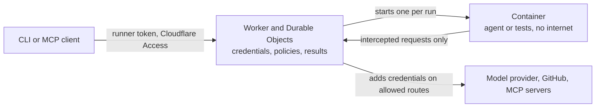

# Sandbox Runner

Run Claude Code, Codex and OpenCode in disposable sandboxes on your own Cloudflare account. Use your subscription or an API key. Decide what each run can reach.

## Why

A coding agent needs real access to do useful work: a model account, your repository, sometimes other tools. The agent also reads content that nobody has reviewed. A prompt injection in that content can make the agent run code that you did not intend ([OWASP Top 10 for Agentic Applications](https://genai.owasp.org/resource/owasp-top-10-for-agentic-applications-for-2026/), ASI01 and ASI05).

On a laptop, a VPS or a shared CI runner, that agent has your files, your network and often your keys within reach. Each run also leaves clones, worktrees, dependency folders and processes behind.

The current recommendation is containment, not trust ([Anthropic's agent containment guidance](https://support.claude.com/en/articles/17316105)). Give each agent its own isolated machine. Keep the credentials in a proxy outside that machine. Block outbound traffic by default. Sandbox Runner applies this to everyday agent work.

## What

Each run gets a sandbox: a new Linux machine for that run only. It is a Cloudflare Container, which [runs in its own virtual machine](https://developers.cloudflare.com/containers/architecture/). The agent can install packages, run code and edit files in it. It cannot reach your computer, your network or your credentials. When the run ends, the Worker destroys the container and everything in it.

- **Your subscription or your API key.** Claude Code and Codex use a Claude or ChatGPT subscription, or an API key. A strategy can start with the API key and change to the subscription when the provider confirms that the key's quota is exhausted. OpenCode uses an OpenAI or Anthropic key.
- **Credentials that the agent never sees.** The container has no internet access and holds placeholder values. The Worker adds the real credentials only to the requests that it allows. These are the model provider, a read-only fetch of your repository and the connectors of the run.
- **Control of each run.** You set the repository, the model, the effort and the MCP connectors. For each connector, you set the tool calls and the arguments that the agent can use. Reviews get read-only connector access.
- **Safe publication.** The container never pushes. The Worker creates one new branch from the changed files, after the container is gone.
- **Independent reviews.** A different agent reviews the commit, for example Codex checks the work of Claude Code.
- **Tests in a sandbox.** Run a Vitest suite or a test command. Dependencies come from the lockfile, and the network is closed while the tests run.
- **Start from anywhere.** Use a terminal or the local MCP server for any run. From ChatGPT, Claude, Claude Code or Codex, people who sign in through Cloudflare Access start the profiles granted to them. Your machine can be off during the run.
- **Nothing built up on your machine.** Your laptop or server runs only the client. Runs leave no clones, dependency folders, caches or processes on it. The CLI keeps only a small private journal of profile submissions.
- **A team without shared secrets.** Give each person or service only the [profiles](#profiles) that it needs. People sign in with their own identity through Cloudflare Access. Scripts use their own tokens.

### Profiles

A profile is a saved run configuration: the agent, its authentication mode, the repository, the model and effort, the MCP connectors and whether the run can publish a branch. The person who starts a profile supplies only the prompt and the commit. The operator decides which client can start which profile. People who use ChatGPT, Claude, Claude Code or Codex through Cloudflare Access always start profiles. See [Profiles, teams and MCP clients](docs/profiles.md).



The [security model](docs/security.md) tells what is protected and what is not.

## How

Install the CLI, deploy the Worker to your Cloudflare account, connect a model provider, then start runs. The [quick start](#quick-start) shows the four steps.

Requirements:

| What | Cost | Notes |
| --- | --- | --- |
| Cloudflare account on the Workers Paid plan | US$5 per month | [Cloudflare Containers](https://developers.cloudflare.com/containers/pricing/) require it. |
| Container usage | Included, then billed by use | At the default size (0.25 vCPU, 1 GiB memory, 4 GB disk), the plan includes about 25 hours of runs each month. After that, a run costs about US$0.03 per hour. |
| Cloudflare Zero Trust | Free plan | Only for the remote MCP endpoint and sign-in with Cloudflare Access. |
| A model provider | Your subscription or API key | A Claude or ChatGPT subscription, or an Anthropic or OpenAI API key. API keys are billed by the provider: set a spending limit. |
| A GitHub App | Free | For every run on a repository, which includes all Vitest and test-command runs. Only private repositories are supported. |
| Node.js 24, Bun, Git, Docker and the Cloudflare `cf` CLI | Free | On the machine that deploys the Worker and connects credentials. Clients need Node.js only. Connecting a Claude subscription runs the local `claude setup-token`. |

Prices are Cloudflare's list prices on the date of this release. Check the pricing page before you rely on them.

Guides:

| Guide | Covers |
| --- | --- |
| [Install and operate](docs/install.md) | Set up, upgrade and remove an installation; installation settings; several installations; admission guard; canary |
| [Credentials and defaults](docs/credentials.md) | Connect Claude Code, Codex and OpenCode; authentication strategies; Claude Code defaults; sandbox provider |
| [Runs](docs/runs.md) | Run a prompt; private repositories and publication; MCP connectors; Vitest and test commands; reviews |
| [Profiles, teams and MCP clients](docs/profiles.md) | Saved profiles; team catalog; remote and local MCP; ChatGPT, Claude, Claude Code and Codex |
| [Governed reviews](docs/review-broker.md) | Route delivery and Tier-2 reviews from an orchestrator |
| [Security model](docs/security.md) | What is protected, what is not, and what the operator does |

Contribute: [CONTRIBUTING.md](CONTRIBUTING.md), [RELEASING.md](RELEASING.md), [SECURITY.md](SECURITY.md).
Questions: [FAQ](#faq).

## Quick start

```sh
npm install --global sandbox-runner-cli

# Deploy the Worker and both container applications to your account.
sandbox-runner cloudflare setup my-sandbox-runner --account <id> --worker my-sandbox-runner \
  --secrets-file /path/to/sandbox-runner.secrets.env

# Connect a model provider. The credential is stored as a Worker secret.
sandbox-runner auth claude --mode subscription --account <id> --worker my-sandbox-runner

# Point the CLI at the Worker, then start a run.
export SANDBOX_RUNNER_URL=https://my-sandbox-runner.<subdomain>.workers.dev
export SANDBOX_RUNNER_TOKEN=<control token>
sandbox-runner claude start 'Summarize what a Durable Object is.'
```

[Install and operate](docs/install.md#set-up-the-worker) explains each step, starting with the secrets file that setup needs.

### Set up with your agent

Paste this prompt into Claude Code, Codex or another coding agent on your machine:

```text
Install Sandbox Runner from https://github.com/digipulse-engineering/sandbox-runner on my Cloudflare account.
Follow the README quick start and docs/install.md.
- Ask me for my Cloudflare account ID and the Worker name before you run any command.
- Let me complete every sign-in and type every API key myself.
- Create the secrets file with the command from docs/install.md. Never print, copy or commit a token, a key or that file.
- Run each command with --dry-run first when it has that option, and show me the result.
- When setup is done, run the canary from docs/install.md and show me its receipt.
```

Give your agent the bundled skill so that it knows the commands, profiles and recovery rules:

```sh
mkdir -p "$agent_skills_dir/sandbox-runner"
sandbox-runner skill > "$agent_skills_dir/sandbox-runner/SKILL.md"
```

Set `agent_skills_dir` to a skill directory that your client loads.

### Prompts for daily work

Use these prompts with an agent that has the skill or a Sandbox Runner MCP server. Replace the parts in angle brackets.

| Goal | Prompt |
| --- | --- |
| Run a task | `Use Sandbox Runner to run this task on commit <sha> of <owner/repo>: <task>. Start my executor profile, wait for the result, then show me the report and the published branch.` |
| Review a commit | `Use Sandbox Runner to review commit <sha> of <owner/repo> with a different agent from the one that wrote it. Check it against: <criteria>. Show me the verdict and the findings.` |
| Run the tests | `Use Sandbox Runner to run the Vitest suite of <owner/repo> at commit <sha>. Show me the failures, if any.` |
| Create a profile | `Use Sandbox Runner to create a profile for <goal> on <owner/repo> from the closest template. Show me the draft before anything is published.` |

## FAQ

### Why Cloudflare and not a local Docker container?

A local container shares your machine, and often your network. Your credentials are usually on that machine too. A Cloudflare Container runs in its own virtual machine, and the credentials stay in a Worker outside it. Runs continue when your machine is off, and you can start them from ChatGPT or Claude.

### Can Cloudflare see my code?

Yes, as any cloud provider can. The runs execute on Cloudflare in your own account. Worker logs are off, and run results stay in Durable Object storage in your account until you remove the installation. The model provider also receives the code that the agent sends to it. See the [security model](docs/security.md).

### Can the agent search the web?

Yes, through the model provider. The container itself has no internet access.

| Action | Where it runs | Result |
| --- | --- | --- |
| Web search by the provider (WebSearch in Claude Code, `web_search` in Codex) | On the Anthropic or OpenAI servers | Allowed in every run. The API runs the search and returns the results to the model in its response. Codex searches OpenAI's cached index, not live pages. |
| Downloads from the container (WebFetch in Claude Code, `curl`, `git clone` or `fetch`) | In the container | Blocked. No data leaves the container. |

The container opens no connection of its own. It talks only to the model provider, through the Worker.

Search results are content that nobody has reviewed, and the search query leaves through the provider. The Worker does not read model requests, so it neither blocks nor limits provider web search. The cached index for Codex is a Codex setting inside the container, not a Worker check.

### Does it work with public repositories?

Not yet. A run checks out a private repository that is on the installation's allowlist. A run without a repository starts with an empty workspace.

### How is it different from Claude Code on the web or Codex cloud?

Those services run the agent in the vendor's sandbox, under the vendor's settings. Sandbox Runner runs Claude Code, Codex and OpenCode in your own account. You set the connector rules, the profiles and who can use them, and the run results stay with you. A review can also use a different agent from the one that wrote the code.

### Can I use my Claude or ChatGPT subscription?

Yes. `sandbox-runner auth` connects a Claude subscription for Claude Code, or a ChatGPT subscription for Codex. The provider's terms decide how you can use your plan, so read the [Anthropic consumer terms](https://www.anthropic.com/legal/consumer-terms) and the [OpenAI terms of use](https://openai.com/policies/terms-of-use). An [authentication strategy](docs/credentials.md#choose-an-authentication-strategy) can start with an API key and change to the subscription when the key's quota is exhausted.

